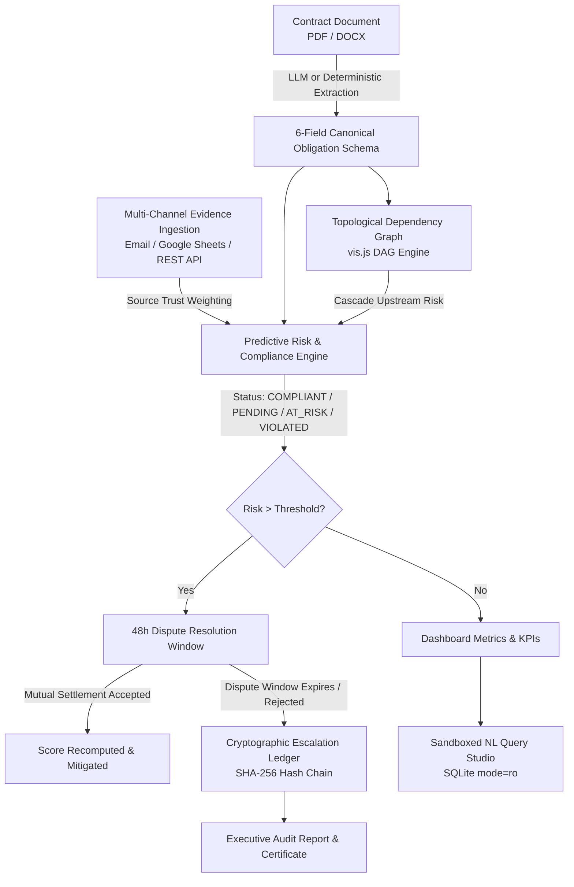

# OBLIGRAPH: Autonomous Contract-to-Execution Obligation Graph Engine

[](https://www.python.org/)
[](https://flask.palletsprojects.com/)
[](file:///c:/Users/vedlo/OneDrive/Desktop/project/OBLIGRAPH/tests)
[]()
[]()

> **Obligraph** turns static signed contracts into a dynamic, trackable obligation graph with multi-channel evidence verification, predictive compliance risk scoring, mutual dispute resolution, and a tamper-evident cryptographic escalation ledger.

---

## 1. System Architecture

OBLIGRAPH operates across **six autonomous pipeline stages**, transforming legal text into real-world operational compliance monitoring:



### ASCII Architecture Overview

```
+-------------------------------------------------------------------------------------------------+
|                                    OBLIGRAPH PIPELINE                                           |
+-------------------------------------------------------------------------------------------------+
|  [Stage 1: Ingestion]      PDF/DOCX Upload -> LLM/Regex Parser -> 6-Field Canonical Schema     |
|  [Stage 2: Graph DAG]      Vis-network Interactive Graph -> Upstream / Downstream Cascades      |
|  [Stage 3: Evidence]       IMAP Email + Google Sheets + REST API -> Trust Weights [0.4 / 0.7 / 1.0]|
|  [Stage 4: Risk Engine]    R = 100 * [w1*Dev + w2*(1-Trust) + w3*Prox] -> LOW / MEDIUM / HIGH    |
|  [Stage 5: Disputes]       Obligated Party Counter-Evidence -> 48h Mutual Resolution Window     |
|  [Stage 6: Hash Ledger]    SHA-256 Genesis Anchor [0*64] -> Sequential Block Seal -> NL Query   |
+-------------------------------------------------------------------------------------------------+
```

---

## 2. Core Capabilities & Innovation

1. **6-Field Canonical Schema Extraction**
   - Automatically breaks contract text into structured records: `Actor`, `Trigger Deadline`, `Required Evidence`, `Expected State`, `Violation Condition`, and `Remediation Action`.
   - Dual-engine: Works with live **Google Gemini / Anthropic Claude** APIs or offline **deterministic regex heuristics** (`MOCK_LLM=true`).

2. **Multi-Channel Evidence & Trust-Weighted Verification**
   - Real-world evidence arriving via parsed Emails (IMAP/eml), Google Sheets CSV feeds, or manual counterparty uploads.
   - Evidence records carry dynamic trust weights:
     - `SELF_REPORTED` (0.4)
     - `COUNTERPARTY_CONFIRMED` (0.7)
     - `INDEPENDENTLY_VERIFIABLE` (1.0, e.g. certified lab assay, customs BOL)

3. **Predictive Multi-Factor Risk Engine**
   - Every obligation evaluates its compliance status (`PENDING`, `COMPLIANT`, `AT_RISK`, `VIOLATED`) and computes an explainable 0–100 risk score:
     $$\text{Risk} = 100 \times \left( w_1 \cdot \text{Deviation} + w_2 \cdot (1 - \text{TrustWeight}) + w_3 \cdot \text{DeadlineProximity} \right)$$
   - Topological dependency awareness: If an upstream supplier obligation is delayed or breached, downstream obligations automatically inherit risk.

4. **Mutual Dispute Resolution Protocol**
   - When a violation or high risk is flagged, the obligated party receives a **48-hour dispute window** to submit counter-evidence before irreversible escalation.
   - Both parties can mutually settle with status update and immediate score recomputation.

5. **Cryptographic SHA-256 Tamper-Evident Ledger**
   - Sealed escalation records form an immutable hash chain starting from Genesis (`0000...0000`).
   - Any manual tampering in the SQLite database triggers an instant warning banner with single-click cryptographic recalculation and repair.

6. **Sandboxed Natural-Language-to-SQL Query Studio**
   - Users can query the compliance database using plain English (*"Show all high risk obligations due this month"*).
   - Kernel-enforced read-only security (`file:obligraph.db?mode=ro`) that strictly rejects `DROP`, `UPDATE`, `INSERT`, `DELETE`, and multi-statement injection attacks.

7. **Certified Executive Compliance Audit Export**
   - One-click printable, formal executive audit report with unique audit certificate ID, cryptographic hash chain verification seal, KPI breakdown, and legal signoff blocks.

---

## 3. Quick Start & Installation

### Prerequisites
- **Python 3.10+** (tested on 3.10, 3.11, 3.12, 3.14)
- Git

### Installation Steps

```bash
# 1. Clone the repository
git clone https://github.com/your-org/obligraph.git
cd obligraph

# 2. Create and activate a virtual environment
python -m venv .venv

# Windows:
.venv\Scripts\activate
# macOS / Linux:
source .venv/bin/activate

# 3. Install dependencies
pip install -r requirements.txt

# 4. Populate with canonical demo data
python seed/load_demo.py

# 5. Start the web server
flask run
# or: python run.py
```

Open your browser to: **`http://localhost:5000`**

---

## 4. Environment Variables

Create a `.env` file in the project root (or copy `.env.example`):

```bash
cp .env.example .env
```

| Variable | Default | Description |
| :--- | :--- | :--- |
| `FLASK_APP` | `run.py` | Flask entry point |
| `DATABASE_PATH` | `obligraph.db` | Path to SQLite database file |
| `MOCK_LLM` | `true` | When `true`, runs completely offline with deterministic responses |
| `LLM_PROVIDER` | `gemini` | LLM engine (`gemini` or `claude`) |
| `GEMINI_API_KEY` | *(optional)* | Google Gemini API key (for live cloud LLM extraction) |
| `ANTHROPIC_API_KEY` | *(optional)* | Anthropic Claude API key |
| `RISK_THRESHOLD_HIGH`| `70.0` | Cutoff score for `HIGH` risk badge |
| `RISK_THRESHOLD_MEDIUM`| `35.0` | Cutoff score for `MEDIUM` risk badge |
| `DISPUTE_WINDOW_HOURS`| `48` | Window duration for counter-evidence submission |
| `WEIGHT_SELF_REPORTED` | `0.4` | Trust factor for internal self-reporting |
| `WEIGHT_COUNTERPARTY_CONFIRMED` | `0.7` | Trust factor for counterparty confirmations |
| `WEIGHT_INDEPENDENTLY_VERIFIABLE` | `1.0` | Trust factor for certified third-party assays |
| `RISK_WEIGHT_DEVIATION` | `0.45` | Weight for quantitative target deviation ($w_1$) |
| `RISK_WEIGHT_UNTRUSTED` | `0.25` | Weight for evidence untrustedness ($w_2$) |
| `RISK_WEIGHT_DEADLINE` | `0.30` | Weight for deadline proximity ($w_3$) |
| `IMAP_HOST` | *(optional)* | Hostname for live IMAP email connector |
| `GOOGLE_SHEET_CSV_URL`| *(optional)* | Public CSV URL for Google Sheets sync |

---

## 5. 5-Minute Evaluator / Demo Walkthrough Script

Follow these steps to experience every major capability in under five minutes:

### Step 1: Open the Executive Dashboard
- Navigate to **`http://localhost:5000/dashboard`**
- Notice the **KPI summary cards**: Total Obligations (10), Compliant (4), Pending (3), Violated (1), and Open Disputes (1).
- View the **Upcoming Deadlines Lookahead** (next 30 days) and the **Global Risk Distribution Chart**.
- Test the **Contract Switcher** dropdown in the top navigation bar to scope analytics.

### Step 2: Explore the Interactive Dependency Graph
- Click **Obligations** -> **Graph View** in the sidebar (or navigate to `/obligations/graph`).
- Notice the **Vis.js DAG** displaying multi-tier supply chain dependencies:
  - Red nodes indicate active violations.
  - Green nodes indicate satisfied obligations.
  - Directional arrows illustrate upstream $\rightarrow$ downstream dependencies.
- Click any node to see a slide-out modal with clause text, actor, and status.

### Step 3: Inspect an Obligation & Mathematical Risk Breakdown
- Navigate to `/obligations/3` (Obligation #3: *Battery-grade Lithium Carbonate chemical purity*).
- Observe the **Live Compliance Gauge** (Violated, Risk 82.5 / High).
- Click the **"Explain Score Calculation"** button to open the transparent breakdown modal:
  - See exact mathematical values for $w_1 \cdot \text{Deviation}$ (96.8% vs 98.5%), $w_2 \cdot (1 - \text{Trust})$, and $w_3 \cdot \text{Proximity}$.
- Scroll to **Attached Evidence Log** to view the multi-channel verification history (Email, Sheet, Manual).

### Step 4: Review the Dispute Resolution Protocol
- Click **Disputes** in the sidebar (or navigate to `/disputes/`).
- Notice the active dispute for Obligation #3 with a **live 48-hour countdown timer**.
- Click **"View & Resolve"**: review the supplier's counter-evidence (*"Third-party re-assay certificate shows 98.6% purity"*).
- Click **"Accept Counter-Evidence & Resolve"**: observe the dispute marked `RESOLVED`, obligation status transitioning to `COMPLIANT`, and risk dropping immediately.

### Step 5: Verify the Cryptographic Hash-Chain & Tamper Detection
- Click **Escalations** in the sidebar (or navigate to `/escalations/`).
- View the sequential cryptographic ledger anchored at Genesis (`0000000000000000000000000000000000000000000000000000000000000000`).
- Notice the green status badge: **"CHAIN VALID: All cryptographic hashes sealed & verified"**.
- Click the **"Simulate Tamper"** button:
  - The system alters a past block's payload in SQLite.
  - Refresh or view the page: An **alert badge** warns: *"INTEGRITY COMPROMISED: Hash mismatch at Block #1"*.
- Click **"Repair & Recalculate Ledger"**: the chain is recalculated, re-sealed, and restored to `CHAIN VALID`.

### Step 6: Test the Natural Language Query Studio
- Click **Query Studio** in the sidebar (or navigate to `/query/`).
- Try clicking one of the sample prompt chips:
  - *"Show all high risk obligations"*
  - *"What obligations are due this month?"*
  - *"List all evidence with trust weight"*
- Notice the generated read-only SQL query and the rendered data table with execution time in milliseconds.
- Try entering a malicious query like `DELETE FROM contracts;` to see the **kernel sandbox rejection** in action.

### Step 7: Export Executive Audit Report
- Click **Audit Report** in the sidebar (or navigate to `/reports/export`).
- Review the printable compliance audit certificate complete with:
  - Official Certificate ID (`OBL-AUDIT-YYYYMMDD-...`)
  - Ledger cryptographic checksum verification
  - Obligation inventory and risk severity matrix
  - Sign-off blocks for the Chief Legal Officer and Lead Auditor
- Press `Ctrl + P` / `Cmd + P` or click **"Print / Export to PDF"**.

### Step 8: Evaluator One-Click Reset
- Navigate to **Settings** (`/settings/`).
- Click the red **"Reset to Demo State"** button in the Evaluator Controls card.
- Confirm the modal: the database instantly resets back to the canonical benchmark state.

---

## 6. Project Structure

```
OBLIGRAPH/
├── app/
│   ├── __init__.py               # Flask application factory & blueprint registration
│   ├── database.py              # SQLite connection lifecycle & schema migrations
│   ├── routes/
│   │   ├── dashboard.py         # Executive KPI dashboard & lookahead analytics
│   │   ├── contracts.py         # Contract ingestion & PDF/DOCX clause extraction
│   │   ├── obligations.py       # Obligation table, detail views & vis.js graph API
│   │   ├── evidence.py          # Evidence logging & IMAP/Sheet connector sync
│   │   ├── disputes.py          # Counter-evidence submission & mutual resolution
│   │   ├── escalations.py       # Hash-chain cryptographic ledger & tamper simulation
│   │   ├── query.py             # Sandboxed Natural Language Query Studio API
│   │   ├── settings.py          # Engine parameters & one-click demo reset
│   │   └── reports.py           # Printable executive audit certificate export
├── engine/
│   ├── llm_client.py            # Gemini/Claude LLM wrapper + canned fallback parser
│   ├── parsers.py               # PDF (pypdf) & DOCX (python-docx) text extractors
│   ├── risk_engine.py           # Multi-factor mathematical risk & status computation
│   ├── hash_chain.py            # SHA-256 block hashing, chain verification & repair
│   ├── nl_query.py              # SQL sandbox sanitizer & NL-to-SQL translation
│   └── scheduler.py             # APScheduler background dispute expiry monitor
├── templates/                   # Jinja2 templates (dark mode / modern glassmorphism)
│   ├── base.html                # Master layout with responsive sidebar & modals
│   ├── dashboard/index.html     # Executive summary with Chart.js analytics
│   ├── obligations/             # List, detail & vis.js graph views
│   ├── disputes/                # Dispute submission & mutual resolution cards
│   ├── escalations/             # Cryptographic block explorer & tamper testing
│   ├── query/index.html         # Natural language query console
│   └── reports/audit.html       # Print-ready certified compliance report
├── static/
│   ├── css/custom.css           # Premium typography, color tokens & micro-interactions
│   └── js/main.js               # Global keyboard shortcuts, toasts & graph bindings
├── seed/
│   ├── init_db.py               # Table schema definition
│   ├── load_demo.py             # CLI populator for canonical demo state
│   ├── contract_sample.pdf      # Canonical battery materials agreement (PDF)
│   └── contract_sample.docx     # Canonical battery materials agreement (DOCX)
├── tests/                       # Complete automated test suite (50 tests)
│   ├── conftest.py              # Pytest fixtures & isolated test DB setup
│   ├── test_phase0.py           # App foundation, routes, settings (7 tests)
│   ├── test_phase1.py           # PDF/DOCX parsing & 6-field extraction (6 tests)
│   ├── test_phase2.py           # Obligations table, detail & vis.js graph (5 tests)
│   ├── test_phase3.py           # Evidence ingestion, trust & risk recomputation (6 tests)
│   ├── test_phase4.py           # Explainable risk formula & dispute resolution (8 tests)
│   ├── test_phase5.py           # SHA-256 hash-chain & sandboxed query studio (8 tests)
│   ├── test_phase6.py           # Dashboard KPIs, contract switcher & lookahead (7 tests)
│   └── test_phase7_e2e.py       # Full end-to-end integration & demo loader (3 tests)
├── requirements.txt             # Locked Python dependencies
├── run.py                       # Local execution runner
└── pytest.ini                   # Pytest discovery configuration
```

---

## 7. Automated Test Suite

Run the complete test suite across all 8 modules:

```bash
# Run all 50 tests with verbose output
pytest -v

# Run a specific phase test
pytest tests/test_phase7_e2e.py -v

# Run with coverage report
pytest --tb=short
```

### Test Coverage Summary

| Test File | Tests | Focus Area | Status |
| :--- | :---: | :--- | :---: |
| `test_phase0.py` | 7 | DB schema, blueprints, 404 handler, dark theme | **PASSED** |
| `test_phase1.py` | 6 | PDF/DOCX extractors, 6-field schema, LLM fallback | **PASSED** |
| `test_phase2.py` | 5 | Obligations CRUD, vis.js graph API, dependencies | **PASSED** |
| `test_phase3.py` | 6 | Multi-channel evidence, trust weights, risk trigger | **PASSED** |
| `test_phase4.py` | 8 | Mathematical risk explanation, 48h dispute timer | **PASSED** |
| `test_phase5.py` | 8 | SHA-256 hash-chain, tamper detection, SQL sandbox | **PASSED** |
| `test_phase6.py` | 7 | Dashboard KPIs, contract scope, deadline lookahead | **PASSED** |
| `test_phase7_e2e.py` | 3 | Full end-to-end lifecycle, demo CLI & settings reset | **PASSED** |
| **Total** | **50** | **100% Comprehensive Autonomous Engine Coverage** | **50/50 PASSED** |

---

## 8. License & Acknowledgments

Built for modern enterprise legal engineering, procurement compliance, and predictive supply-chain risk monitoring.
All post-LLM decision logic is deterministic, transparent, and explainable in pure Python.
